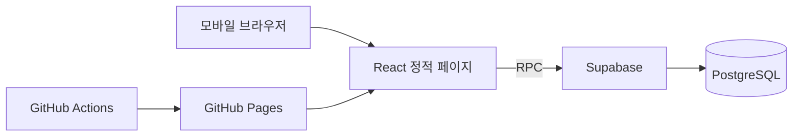

# MyWeddingCard 💌

결혼 준비를 하면서 모바일 청첩장을 직접 만들어보고 싶어 시작한 프로젝트입니다.

시중에 있는 청첩장 서비스도 편리하지만, 처음 화면이 열리는 방식이나 스크롤 애니메이션, 사진 배치 등을 원하는 대로 바꾸고 싶었습니다. 만들다 보니 방명록과 참석 여부(RSVP)를 저장하는 기능까지 추가하게 됐습니다.

React로 화면을 만들고 GitHub Pages에 배포하며, 데이터가 필요한 기능은 Supabase를 사용합니다.

## 구현한 기능

- 인트로 화면과 스크롤 애니메이션
- 예식 정보, 달력, 카운트다운
- 사진 갤러리와 확대 보기
- 카카오·네이버 지도와 길찾기
- 방명록 작성/삭제, 참석 여부(RSVP) 등록
- 연락처·계좌번호 복사
- 배경음악 재생 제어
- 링크 공유, OG 미리보기, 초대장 이미지 저장

## 구현하면서 고민했던 부분

### 정적 사이트에서 방명록을 어떻게 저장할까?

처음부터 별도 서버를 운영하고 싶지는 않았습니다. 화면은 GitHub Pages에 올리고 방명록·RSVP만 Supabase PostgreSQL에 저장하는 방식으로 구성했습니다.

브라우저에서 DB 테이블을 직접 수정하도록 두는 대신, RLS로 테이블 접근을 제한하고 PostgreSQL RPC 함수로 입력·삭제 등의 요청을 처리하도록 했습니다. 입력값 검증과 요청 제한도 함수 쪽에 두었습니다.

관련 코드는 [supabase/schema.sql](supabase/schema.sql)에 있습니다. 다만 실제 배포 DB의 권한 설정까지 별도로 확인해야 보안 상태를 판단할 수 있습니다.



### 모바일에서 처음 열릴 때 너무 무겁지 않도록

사진과 애니메이션이 많은 페이지라 초기 로딩을 신경 썼습니다. 첫 화면에 필요한 부분을 먼저 보여주고 아래쪽 섹션은 나중에 불러오도록 나눴습니다. 지도나 이미지 저장 기능도 필요한 시점에 로드하는 구조를 사용했습니다.

성능 점수를 따로 측정해 정리한 것은 아니라서, 추후 Lighthouse 등으로 확인해 보려고 합니다.

### 참석 여부를 수정할 때

RSVP는 한 번 제출한 내용을 다시 수정할 수 있어야 했습니다. 이를 위해 수정용 키를 사용하는 흐름을 구성하고, 중복 제출과 잘못된 키, RPC 오류가 발생했을 때의 동작을 테스트 코드로 작성했습니다.

테스트 코드는 [tests/rsvp.test.mjs](tests/rsvp.test.mjs)에서 확인할 수 있습니다. 아직 `package.json`에 `npm test` 명령을 넣거나 CI에 연결하지는 않았습니다.

## 사용 기술

| 구분 | 기술 |
| --- | --- |
| Frontend | React 19, TypeScript, Vite |
| Animation | Framer Motion |
| Styling | CSS Modules, CSS Variables |
| Database | Supabase PostgreSQL, RLS, RPC |
| 기타 | Kakao Maps, Naver Maps, html-to-image |
| Deployment | GitHub Actions, GitHub Pages |

## 프로젝트 구조

```text
src/
├── data/          # 청첩장에 들어가는 내용
├── components/    # 화면 구성
├── hooks/         # 공통 훅
├── lib/           # Supabase, RSVP, 공유 기능
└── styles/        # 스타일

supabase/schema.sql       # DB 및 RPC 함수
tests/rsvp.test.mjs       # RSVP 관련 테스트
.github/workflows/        # GitHub Pages 배포
docs/SETUP.md             # 환경 설정 가이드
```

이름이나 일정 같은 내용은 `src/data/`에서 관리하고, 빌드 시 일부 데이터를 OG 메타태그에도 반영합니다.

## 로컬에서 실행하기

```bash
npm install
# .env.example 파일을 참고해 .env 작성
npm run dev
```

빌드 및 타입 확인:

```bash
npm run typecheck
npm run build
npm run preview
```

환경변수와 외부 서비스 설정은 [SETUP.md](docs/SETUP.md)에 정리했습니다. 키가 없으면 일부 기능은 제한되거나 대체 화면으로 동작할 수 있습니다.

`main`에 푸시하면 [배포 워크플로](.github/workflows/deploy.yml)가 GitHub Pages 빌드와 배포를 진행합니다.

## 앞으로 보완할 부분

- RSVP 테스트를 명령어와 CI에 연결하기
- Supabase RPC와 RLS 정책 통합 테스트
- 모바일 성능 측정 및 최적화
- DB 백업과 무료 프로젝트의 일시중지에 대비하기

실제 초대장 콘텐츠에는 연락처나 예식 정보가 포함될 수 있습니다. 공개할 자료와 환경변수는 별도로 확인하고 있으며, `VITE_`로 시작하는 값은 브라우저에 노출된다는 점을 고려해 관리자 비밀키는 사용하지 않습니다.

---

[GitHub 프로필](https://github.com/Leeeyounghwan)
