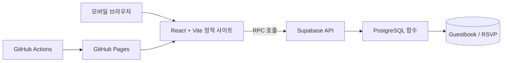

<div align="center">

# 💌 MyWeddingCard
**모바일 청첩장 — 정적 웹과 데이터 서비스를 연결한 개인 프로젝트**

    

</div>

## 1. 왜 만들었나요?

결혼 준비 과정에서 **모바일 청첩장의 디자인과 사용자 경험을 직접 제어**하고 싶어 시작했습니다. 정적 호스팅의 장점을 유지하면서도 방명록과 참석 여부(RSVP)처럼 데이터를 저장해야 하는 기능을 구현하는 것이 핵심 과제였습니다.

이 저장소는 실제 초대장 콘텐츠를 포함할 수 있습니다. 개인정보가 담긴 화면·데이터의 재배포에는 주의해 주세요.

## 2. 주요 기능

| 영역 | 기능 |
| --- | --- |
| 초대 경험 | 인트로, 스크롤 애니메이션, 예식 카운트다운·달력 |
| 콘텐츠 | 인사말, 갤러리·확대 보기, 연락처·계좌 복사 |
| 위치 | 카카오/네이버 지도, 교통·길찾기 안내 |
| 참여 | 방명록 작성·삭제, 참석 여부(RSVP) 기록 |
| 공유 | Open Graph 메타데이터, 링크 복사, 초대장 이미지 저장 |
| 편의 | 배경음악 제어, 반응형 모바일 UI |

## 3. 시스템 설계



| 영역 | 구현 기술 |
| --- | --- |
| Frontend | React 19, TypeScript, Vite |
| Animation | Framer Motion / LazyMotion |
| Styles | CSS Modules / CSS Variables |
| Database | Supabase PostgreSQL |
| Access | Row Level Security, PostgreSQL RPC |
| Deployment | GitHub Actions → GitHub Pages |

### Engineering Decisions

**① 정적 사이트 + DB**
별도 상시 실행 서버 없이 GitHub Pages에서 화면을 제공하고, 쓰기 기능은 Supabase RPC를 이용합니다. 따라서 앱 배포와 DB 운영의 책임을 분리했습니다.

**② 테이블 직접 접근 대신 RPC**
[DB 스키마](supabase/schema.sql)에서 방명록·RSVP 테이블의 RLS를 활성화하고 브라우저 역할의 직접 접근 권한을 제한합니다. 데이터 처리는 `security definer` 함수에서 검증하는 방식입니다. **함수 권한과 실제 배포 DB 설정에 대한 별도 보안 검증은 필요**하며, 문서상 설계를 보안 인증으로 해석해서는 안 됩니다.

**③ 모바일 초기 로딩**
첫 화면과 하단 섹션을 분리해 지연 로딩하며, 지도·이미지 저장 등 일부 기능은 필요할 때 불러옵니다. 성능 개선의 방향을 반영한 구조이며 측정 점수는 기재하지 않았습니다.

**④ 데이터와 UI 분리**
청첩장 콘텐츠는 `src/data/`에서 관리하고, 빌드 과정에서 일부 SEO/OG 메타데이터에 활용합니다.

**⑤ 실패 흐름 테스트**
[RSVP 테스트](tests/rsvp.test.mjs)에는 수정용 키 생성, 잘못된 키, 중복 전송, RPC 실패 처리 등의 사례가 포함되어 있습니다.

## 4. 프로젝트 구조

```text
MyWeddingCard/
├── .github/workflows/deploy.yml  # Pages 배포 자동화
├── public/                       # 이미지·오디오 등
├── src/
│   ├── data/                     # 초대장 콘텐츠
│   ├── components/               # 화면 섹션
│   ├── hooks/                     # 공통 훅
│   ├── lib/                       # Supabase, RSVP, 공유 등
│   └── styles/                    # 디자인 스타일
├── supabase/schema.sql           # DB·RLS·RPC
├── tests/rsvp.test.mjs           # RSVP 테스트
└── docs/SETUP.md                 # 설치와 설정
```

## 5. 로컬 실행

```bash
npm install
# .env.example을 참고하여 .env 작성
npm run dev
```

```bash
npm run typecheck
npm run build
npm run preview
```

키가 없는 로컬 환경에서는 일부 외부 연동 기능이 대체 동작하거나 제한될 수 있습니다. 구체적인 변수와 설정 방식은 [SETUP](docs/SETUP.md)을 참고하세요.

## 6. 테스트·배포 현황

- **테스트 코드:** `tests/rsvp.test.mjs`에 RSVP 핵심 흐름 검증 사례가 있습니다.
- **주의:** 현재 `package.json`에는 별도 `npm test` 명령이 없습니다. 테스트 코드 존재와 CI 자동 실행을 혼동하지 마세요.
- **빌드:** `npm run build`는 TypeScript 빌드 검사와 Vite 프로덕션 빌드를 실행합니다.
- **배포:** [GitHub Actions](.github/workflows/deploy.yml)에서 `main` push 시 GitHub Pages 배포를 수행합니다.

## 7. 보안 및 운영 시 고려 사항

- `VITE_` 환경변수 값은 브라우저 빌드 결과에 포함됩니다. **절대로 service_role 키나 관리자 비밀키를 넣지 않습니다.**
- RLS·RPC는 접근 통제를 위한 설계이며, 배포된 DB의 실제 권한과 예외 경로까지 별도로 검증해야 합니다.
- 방명록·RSVP에는 개인정보가 포함될 수 있으므로 공개 저장소에 운영 데이터·비밀번호·실제 키를 업로드하지 않습니다.
- Supabase 무료 프로젝트의 비활성 일시중지 가능성을 고려해 서비스 운영 중 가용성과 데이터 백업을 점검해야 합니다.
- 초대장에 노출되는 개인 정보, 연락처, 장소, 사진 등은 공개 범위를 검토해야 합니다.

## 8. 후속 개선

- RSVP 테스트 실행 명령 및 CI 통합
- RPC와 실제 PostgreSQL 정책을 검증하는 통합 테스트
- 모바일 성능 측정 및 개선 전후 자료
- 민감 데이터의 공개 범위와 백업·서비스 가용성 점검

---
[개발자 프로필](https://github.com/Leeeyounghwan) · [프로젝트 소스](https://github.com/Leeeyounghwan/MyWeddingCard)
